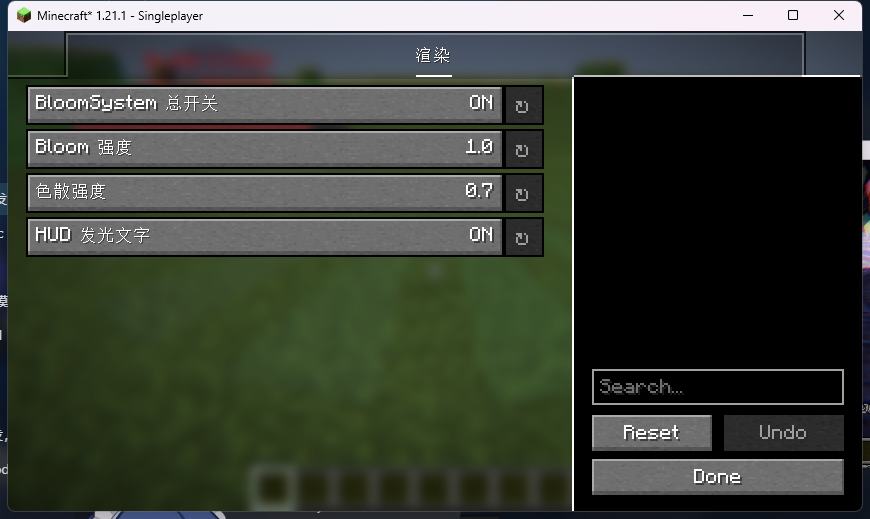
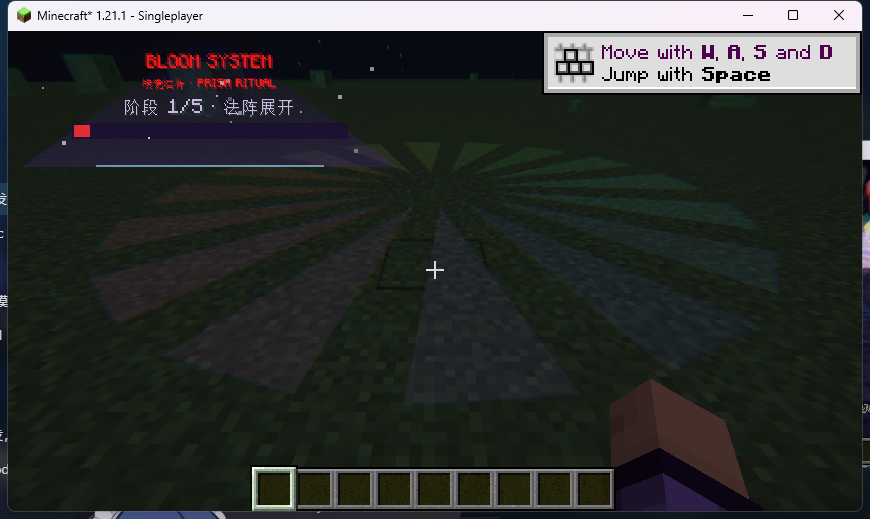
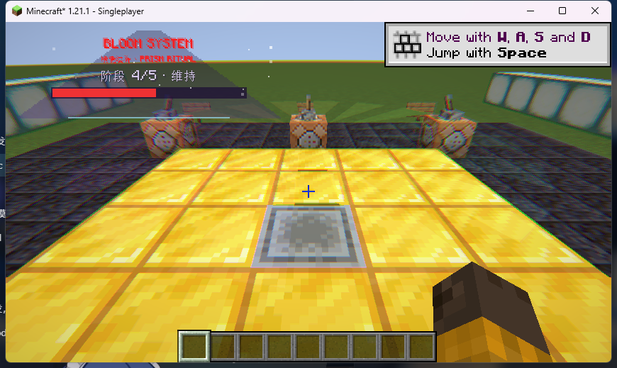

# BloomSystem Renderer (Minecraft 1.21.1 / Fabric)

> GitHub: https://github.com/Ra1nPoem/bloomsystem  ·  Release: https://github.com/Ra1nPoem/bloomsystem/releases

BloomSystem 风格的法术特效渲染器垂直切片：**Veil 渲染管线 + 彩虹 HUD + 服务端最小触发包 + Cascade 风格时间线**。

> 目标版本选择 **1.21.1 Fabric**：Veil 4.5.2 目前只发布 1.21.1 版本（[Modrinth: Veil](https://modrinth.com/mod/veil)）。
> 版本号全部集中在 `gradle.properties` 的 `minecraft_version` / `loader_version` / `veil_version` 等字段，便于后续切换。

---

## 1. 当前已实现（垂直切片）

| 需求 | 状态 | 说明 |
|---|---|---|
| Veil 渲染管线 | ✅ 已接入 | `foundry.veil:veil-fabric-1.21.1:4.5.2`；Veil 启动、bloom pipeline 启用 |
| Veil 后处理（色差色散） | ✅ 已注册 | `assets/bloomsystem/pinwheel/post/chromatic.json` + 原创 `chromatic.fsh`；运行时通过 `PostProcessingManager.add(bloomsystem:chromatic)` 激活 |
| 世界空间魔法阵 | ✅ 可运行（首版） | 多层线框环 + 径向光带 + 旋转三角刃面；已切换为 **Veil `VeilRenderLevelStageEvent`（AFTER_ENTITIES）** + Veil MatrixStack/BufferSource |
| 彩虹发光 HUD 文字 | ✅ | 逐字符 HSL 色相滚动 + 外发光偏移；`BloomHud` |
| 三角渐变 UI 面板 | ✅ | 屏幕空间三角渐变 + 边缘星光 + 阶段/彩虹进度条 |
| 服务端最小触发包 | ✅ | `BloomTriggerPayload(skillId,x,y,z,timestamp)`；`/bloom trigger [targets] [skill]` |
| Cascade 风格时间线 | ✅ | `BloomTimeline`：deploy/charge/burst/sustain/fade，缓动/回调/进度 |
| CCA 数据组件 | ✅ 已接入 | `custom.cardinal-components` 声明 + `cardinal-components` entrypoint；PlayerComponent 注册成功，客户端无崩溃 |
| YACL 配置面板 | ✅ 已接入 | 默认按键 **B** 或客户端命令 **/bloomconfig** 打开；总开关/Bloom 强度/色散/HUD 开关，保存到 `config/bloomsystem.properties` |
| GPU 实例化棱镜碎片 | ⬜ 未实现 | 首版为 CPU 几何；下一步用 Veil Quasar / 自定义 instancing |
| Veil bloom mask | ✅ 已接入 | 自有 Veil shader program `bloomsystem:circle` + `circle_bloom` render type（`minecraft:output` → `veil:bloom`），不再崩溃；亮度/曝光待调 |
| Sodium + Iris 兼容 | ⚠️ 未实测 | 当前无 Canvas/FREX；Veil 本身兼容 Iris，需后续跑 Sodium/Iris 组合测试 |
| 自动截图 demo | ✅ | 进入世界约 2 秒自动触发棱镜法阵（正式服使用 `/bloom trigger`） |

## 2. 目录结构（按需求规划）

```
com.bloomsystem
├─ BloomSystem                 // 主入口：注册网络/命令
├─ config.BloomConfig          // YACL 配置占位
├─ network
│  ├─ BloomNetwork             // /bloom trigger，仅下发最小 payload
│  └─ BloomTriggerPayload      // skillId + pos + timestamp
└─ client
   ├─ BloomSystemClient        // 客户端入口：世界渲染/HUD/Veil 后处理注册
   ├─ BloomState               // 客户端演出状态（后续迁到 CCA PlayerComponent）
   ├─ BloomTimeline            // Cascade 风格时间线
   ├─ BloomWorldRenderer       // 魔法阵世界渲染（顶点消费者 + RenderLayer）
   └─ BloomHud                 // 彩虹文字 + 三角渐变面板 + 星光
```

Veil 资源：

```
src/main/resources/assets/bloomsystem/pinwheel/
├─ post/chromatic.json                 // Veil PostPipeline（bloomsystem:chromatic）
└─ shaders/program/
   ├─ chromatic.json                   // 程序描述：veil:blit_screen + bloomsystem:post/chromatic
   └─ post/chromatic.fsh               // 原创色差色散/色相滚动/暗角 shader
```

## 3. 构建 / 运行

前置：Java 21（本机 `java-runtime-delta`），Gradle 9.5+（Loom 1.16.3 需要 plugin API ≥ 9.4）。

```powershell
$env:JAVA_HOME='C:\Users\op\AppData\Roaming\.minecraft\runtime\java-runtime-delta'
cd D:\MINE\bloomsystem
# 用 Gradle 9.5/9.8（Loom 1.16.3）
C:\Users\op\.gradle\wrapper\dists\gradle-9.5.0-bin\<hash>\gradle-9.5.0\bin\gradle.bat build
# 产物：build/libs/bloomsystem-0.1.0.jar
```

运行 demo（`build.gradle` 已给 `runClient` 配置了 `--quickPlaySingleplayer TestWorld`）：

1. 把一个 1.21.1 世界放到 `run/saves/TestWorld`（本仓库 demo 已附带）；
2. `gradle runClient`；
3. 进入世界约 2 秒后自动触发一次「棱镜法阵」：HUD 彩虹文字/三角面板 + 世界线框法阵；
4. 正式服务器：`/bloom trigger @a prism_ritual`（需要 OP）。

## 4. 已完成验证

- `gradle build` 成功：`build/libs/bloomsystem-0.1.0.jar`（26 KB 左右）；
- 真实 Fabric 1.21.1 客户端启动（Fabric Loader 0.18.4 + Fabric API 0.116.8+1.21.1 + Veil 4.5.2），
  日志：`[BloomSystem] client initialized`、`Veil chromatic post pipeline registered id=bloomsystem:chromatic`；
- Demo 自动触发并渲染 HUD/世界法阵；截图：`docs/screenshots/yacl-config.png`（YACL 配置面板）、`docs/screenshots/world-fx.png`（Veil 世界 + HUD + bloom）。





## 5. 下一步（对应需求完整验收）

1. 世界渲染从 Fabric `WorldRenderEvents` 切到 **Veil `VeilRenderLevelStageEvent`**，使用 Veil BufferBuilder/矩阵栈；
2. 魔法阵几何通过 **Veil bloom shard/输出层** 进入 `veil:bloom`，实现真正的 glow mask；
3. 棱镜碎片改为 **GPU 实例化**（Veil Quasar 或自定义 instancing），CPU 只更新时间线；
4. CCA：把 `BloomState` 迁到 `PlayerEntity` 组件，用于 hue/phase/weapon buff；
5. YACL：配置界面（Bloom 强度/色散/粒子上限/总开关）；
6. Sodium + Iris 组合实机验证；Iris shaders 加载时禁用/降级后处理；
7. 武器星辉（自发光 mask + bloom）与彩虹发光文字 HUD 贴图/描边 shader。

## 6. 已知限制

- ImGuiMC 是 Veil 的编辑器依赖（本机 maven 不可达）；当前构建/运行不依赖编辑器，未安装也能启动；
- 本机首次构建下载 1.21.1 资源/依赖较慢（约 10 分钟）；
- 自动 demo 仅用于截图，生产服务器请用 `/bloom trigger`；
- 世界法阵首版是 CPU 几何，不是最终 GPU 实例化版本。


## 7. 命令方块测试地图



- 发布包：[BloomSystem-测试地图.zip](https://github.com/Ra1nPoem/bloomsystem/releases)（含 TestWorld + README-测试地图.txt + 截图）
- 平台：黑石/金块法阵平台 + 6 个拉杆站：南侧触发/观看位/触发，北侧触发/午夜/白天；
- 拉杆触发 `/bloom trigger @p prism_ritual`；B 或 `/bloomconfig` 打开 YACL 配置；
- 开发重建脚本：`scripts\build-bloomsystem-testmap.ps1`（RCON 25575）。
